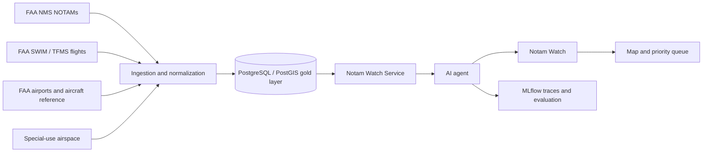

# Notam Watch

**Notam Watch helps pilots and analysts see which aviation notices matter to a
flight and why.** It checks the route, altitude, and timing against FAA notices
(NOTAMs), then explains what deserves attention in plain language.

Built for the **2026 GSA MCP Server and SI Agent Government Hackathon**.

## What It Found

> “I'm flying from JFK to Washington National at 30,000 feet. Which safety
> notices matter most for this flight, and why?”

In a November 18, 2026 replay, Notam Watch found four hazard areas that crossed
the planned route. Three matched the flight's expected altitude and timing.
The fourth stayed flagged for review: its height limit was measured from the
ground, and without terrain data the tool couldn't tell whether the flight
would pass through it. This was a replay, not a current flight briefing.

## Does It Work?

In the November 20, 2026 evaluation, the assistant selected the expected
aviation tool on **all nine test questions**. That shows it chose the right tool
for each question, not that every answer was correct.
[Technical evaluation details (for engineers)](EVALUATION.md)

## Why Trust It?

- The assistant can look up aviation data, but it can't change operational records.
- The tools report how current their data is and flag what they can't verify.
- People make the final call. Notam Watch does not replace an official FAA
  briefing, air traffic control, dispatch, or pilot judgment.

## For Judges: Source Review Guide

The submitted PowerPoint, evaluation document, and video present the problem,
demonstration, and measured results. This repository provides the implementation
evidence behind those materials; judges are not expected to deploy or run it.

| GSA criterion | Where to look | What it demonstrates |
| --- | --- | --- |
| **Mission alignment** | [The problem](#the-problem-notam-overload-without-flight-context) and [operational experience](#the-operational-experience) | Reduces NOTAM information overload for pilots and 24-hour aviation analysts while preserving uncertainty and official-procedure boundaries. |
| **Technical quality** | [MCP registration](src/server/app.py), [tool contracts](src/server/tools), [query layer](src/server/tool_resources/queries), and [testing](#testing-and-evaluation) | Read-only MCP server, FAA data integration, PostGIS route and airspace analysis, typed tool contracts, freshness metadata, and automated tests. |
| **Innovation** | [Why MCP matters](#why-mcp-matters-here) | Connects language-model reasoning to route, altitude, schedule, geometry, live position, and flight-plan evidence rather than relying on text search alone. |
| **Presentation support** | [Agent orchestration](agent-app/agent.py), [dashboard data model](agent-app/dashboard.py), [user interface](agent-app/static/index.html), and [MLflow evaluation](agent-app/evaluation.py) | The source behind the map-centered workspace, visible MCP tool calls, plain-language explanations, and evaluation results shown in the submitted video and documents. |

### Suggested source review path

1. Start with [`src/server/app.py`](src/server/app.py) to see the MCP server,
   resources, prompts, and tool registration.
2. Review [`src/server/tools/`](src/server/tools) for the six typed MCP tool
   contracts exposed to AI clients.
3. Review [`src/server/tool_resources/queries/`](src/server/tool_resources/queries)
   for the deterministic route, altitude, time, geometry, and freshness logic.
4. Review [`agent-app/agent.py`](agent-app/agent.py) and
   [`agent-app/static/index.html`](agent-app/static/index.html) for tool selection,
   evidence labeling, and the analyst experience shown in the video.
5. Review [`agent-app/evaluation.py`](agent-app/evaluation.py) for the
   mission-focused MLflow evaluation demonstrated in the submitted materials.

### How to read the project without being a programmer

Think of the project as five connected parts:

| Project part | Plain-language role | Source evidence |
| --- | --- | --- |
| **MCP server** | The front desk. It tells an AI assistant which aviation capabilities are available and accepts structured requests. | [`src/server/app.py`](src/server/app.py) |
| **MCP tools** | Six specialized questions the assistant can ask, such as “What matters along this route?” or “Which flights are approaching a restriction?” | [`src/server/tools/`](src/server/tools) |
| **Aviation analysis** | The calculator. It compares routes, locations, times, altitudes, and hazard boundaries using FAA data. | [`src/server/tool_resources/queries/`](src/server/tool_resources/queries) |
| **Analyst workspace** | The visual experience shown in the video: map, priority information, chat, tool-use labels, and evaluation results. | [`agent-app/`](agent-app) |
| **Evaluation** | The quality check. It asks repeatable mission questions and records whether the agent used evidence, selected the right capability, and produced a useful answer. | [`agent-app/evaluation.py`](agent-app/evaluation.py) |

The language model does not independently calculate whether a flight intersects
a hazard. The MCP tools retrieve and calculate the aviation evidence; the model
selects a tool and explains the returned result in more familiar language.

### Quick glossary

- **NOTAM** — a time-sensitive aviation notice about a condition such as a
  runway closure, navigation outage, temporary restriction, or unmanned-aircraft
  activity.
- **MCP** — a standard way for an AI application to discover and call approved
  tools instead of inventing an answer or connecting directly to every system.
- **TFR** — a temporary flight restriction affecting a defined area, time, and
  sometimes altitude range.
- **Flight plan** — the filed or planned route and supporting details used to
  evaluate what may affect a flight before departure.
- **PostGIS** — the mapping capability used by the database to compare flight
  paths with aviation hazard areas.
- **MLflow** — the evaluation and tracing system used to record what the agent
  did, which tools it called, how long it took, and how the answer was scored.

## The Problem: NOTAM Overload Without Flight Context

Traditional NOTAM retrieval can answer, “What notices exist?” The operational
question is harder:

- Which notices intersect this flight's planned or remaining route?
- Will the notice be active when the aircraft reaches it?
- Does the aircraft's altitude overlap the affected altitude range?
- Is a nearby flight actually entering restricted airspace, or merely passing
  above or beside it?
- Which notice deserves attention first?
- Which conclusions are confirmed, and which remain uncertain because altitude,
  schedule, terrain, or freshness evidence is incomplete?

The difference between a large notice list and a useful briefing is context.
Notam Watch combines that context before asking the model to explain it.

## The Solution

The project has two user-facing components:

1. **Notam Watch Service** — a standardized, read-only MCP interface over live and
   reference aviation data.
2. **Notam Watch** — an analyst dashboard and AI assistant that uses the
   MCP server, shows which tools were called, and applies the returned evidence
   to the map and priority queue.

The MCP tools perform the deterministic retrieval and geospatial analysis. The
language model selects the appropriate tool, prioritizes the returned evidence,
explains aviation terminology, and communicates uncertainty in plain language.

## The Operational Experience

The dashboard is designed around the workflow of a 24-hour aviation analyst:

- A national map displays flight positions, relevant NOTAM reference locations, and
  route context.
- Summary cards highlight critical notices, high-priority notices, unresolved
  cases, and flights currently on screen.
- A priority queue explains why each notice is shown and which flights are
  associated with it.
- The assistant accepts everyday-language questions about flights, routes,
  airports, temporary restrictions, and safety notices.
- Every answer is labeled as either **MCP-grounded** or **model-only**.
- MCP-grounded answers display the exact tools selected by the agent.
- Selecting a NOTAM produces a plain-language explanation for users who do not
  routinely read coded NOTAM text.
- Question-specific tool evidence filters the dashboard, connecting the answer
  to visible flights and hazards.
- A one-time startup briefing names the MCP tool used to populate the temporary
  flight restriction snapshot. Manual refreshes preserve the current map location.

## Six MCP Tools, One Operational Workflow

| MCP tool | Operational question it answers |
| --- | --- |
| `find_flight_plan` | “What future or planned flight matches this airline flight number, origin, and approximate departure time?” |
| `get_route_notams` | “Which departure, en-route, and arrival notices matter to this planned flight?” |
| `get_flights_approaching_notams` | “Which flights are inside or approaching an active temporary restriction or special-use airspace?” |
| `get_flight_briefing` | “What should this currently tracked flight know about first?” |
| `find_route_deviations_near_notams` | “Which flights are moving away from their planned routes near newly active NOTAM areas?” |
| `search_notams` | “What current runway, approach, airspace, or unmanned-aircraft notices match this airport or location?” |

The server also exposes five reusable MCP prompts and an `nfs://info/server`
resource describing its capabilities and data boundaries.

Try: “I’m flying from JFK to Washington National (KDCA) at 30,000 feet.
Which flight safety notices matter most, and why?”

## Why MCP Matters Here

Without MCP, an AI assistant may produce a fluent explanation without retrieving
current evidence. With MCP:

- Tool descriptions tell the model which aviation capability to select.
- Typed inputs constrain flight, airport, time, altitude, location, and hazard
  filters.
- Structured outputs preserve callsigns, routes, timing, altitude relationships,
  NOTAM identifiers, geometry evidence, and freshness metadata.
- The UI can show exactly when a tool was used and replay the same evidence on
  the map.
- The server remains reusable by clients other than this demonstration app.

The result is not simply a chatbot connected to a database. It is a governed
interface between an AI agent and aviation-specific analytical capabilities.

## Architecture



### Data and analysis

- **FAA NMS NOTAMs** provide current notices and published hazard geometry.
- **FAA SWIM/TFMS** provides flight positions and planned routes.
- **NASR and aircraft reference data** provide airport and aircraft context.
- **Special-use airspace data** provides named areas and published schedules.
- **PostgreSQL/PostGIS** performs route-corridor, area, proximity, and vertical
  relevance analysis.
- Successful tool results include `data_status` freshness information.

The MCP server reads from the serving database but does not write to it. The
Databricks ingestion pipeline runs separately from the MCP runtime.

## Testing and Evaluation

See the [technical evaluation details](EVALUATION.md) for the nine-question
evaluation, its scoring criteria, and instructions for running automated checks.

## Security and Operational Boundaries

- The MCP server is read-only and exposes no operational write tools.
- Database queries use typed inputs and parameterized SQL.
- Credentials are supplied through environment variables or managed Databricks
  resources and are not committed to the repository.
- Databricks app-to-app calls use the application service principal.
- Tool responses expose freshness and uncertainty instead of allowing the model
  to imply certainty that the data does not support.
- The agent is instructed not to invent flights, NOTAMs, destinations, or
  unsupported causal explanations.
- All results remain advisory and must be verified through authoritative FAA and
  operational procedures.

## Known Limitations and Future Work

- Map markers show representative NOTAM locations; MCP filtering uses the full
  stored hazard geometry.
- Without terrain elevation, the tool leaves above-ground-level altitude
  relationships unresolved rather than treating them as confirmed or irrelevant.
- Live-flight conclusions depend on the freshness and completeness of the FAA
  source feeds.
- Airline schedules and filed flight plans can change, and some future flights
  may not yet be available in TFMS.
- As additional patterns were discovered in real data, the project required
  iterative changes to the data model. Production governance should preserve
  that ability while versioning tool and schema contracts.

### Future Considerations

**Roadmap only — not implemented in the current app or MCP server.**

- **Route-specific weather alerts.** Match new or materially changed icing,
  turbulence, and thunderstorm advisories to a flight's route, altitude, and
  expected time through the area. Show what changed and flag stale or missing
  weather information rather than treating it as clear conditions.
- **Rerouting after an FAA ground stop.** Use FAA advisories and filed flight
  plans to show which departures are held and when restrictions change. Once
  restrictions allow it, compare published reroutes and later departure windows
  for dispatcher review. The service would not file flight plans, release
  flights, or issue clearances.

Start by replaying archived advisories and flight plans to measure warning lead
time, missed impacts, and duplicate alerts.

## Deployment and Continuity

The hackathon implementation was designed to run on Databricks Apps with a
Lakebase PostgreSQL/PostGIS serving layer, Databricks model serving, and MLflow.
The standalone Docker environment used to record the evaluation is not included
in this source submission.

### Databricks hackathon deployment

The Databricks architecture uses two Apps:

1. Deploy the repository root as the `mcp-nfs` MCP server.
2. Deploy `agent-app/` as the `nfs-aviation-agent` dashboard.

The server reads from a Lakebase PostgreSQL/PostGIS serving layer. The agent app
uses Databricks app resources for MCP access, model serving, and MLflow tracing.
See `agent-app/README.md` and `ingestion/README.md` for deployment details.

### MCP server development

Install [`uv`](https://docs.astral.sh/uv/), then run:

```bash
uv sync --group dev
uv run python main.py
```

The default transport is `stdio`, suitable for an MCP client. To use
streamable HTTP:

```bash
MCP_TRANSPORT=streamable-http uv run python main.py
```

The default endpoints are:

- MCP: `http://localhost:8000/mcp`
- Health: `http://localhost:8000/health`
- Version: `http://localhost:8000/version`

## Repository Guide

```text
src/server/       MCP server, tools, prompts, resources, and query layer
agent-app/        Map-centered analyst UI, agent, and MLflow evaluation
ingestion/        Databricks jobs and aviation data normalization
tests/            MCP server and dashboard tests
```

### Tool implementation map

| MCP tool | Query implementation | Primary SQL |
| --- | --- | --- |
| `find_flight_plan` | `queries/flight_plans.py` | `find_flight_plans.sql` |
| `get_route_notams` | `queries/route_notams.py` | `route_by_*.sql`, `route_great_circle.sql`, `hazards_along_route.sql`, `airport_notams.sql` |
| `get_flights_approaching_notams` | `queries/flights_approaching.py`, `queries/airspace.py` | `flights_approaching_hazards.sql`, `sua_published_times.sql`, `sua_airspace.sql` |
| `get_flight_briefing` | `queries/flight_briefing.py` | `flight_briefing.sql` and route-corridor analysis |
| `find_route_deviations_near_notams` | `queries/route_deviations.py` | `route_deviations.sql` |
| `search_notams` | `queries/search.py` | `search_notams.sql` |

## Project Origin

The idea grew from earlier work on manually prioritizing and filtering NOTAMs.
That work demonstrated both the value of flight-specific filtering and the cost
of continually adding new rules as previously unseen data patterns appeared.

MCP provides a path to accelerate that modernization: keep the deterministic
aviation analysis in reusable, testable tools while allowing different AI
clients to ask operational questions in everyday language.

## License

The Notam Watch project code, including the code that retrieves FAA data, is
available under the [MIT License](LICENSE). This license does not grant rights to
FAA data obtained through SWIM or the NOTAM Management Service (NMS), or to
third-party materials. Those remain subject to their applicable terms.
